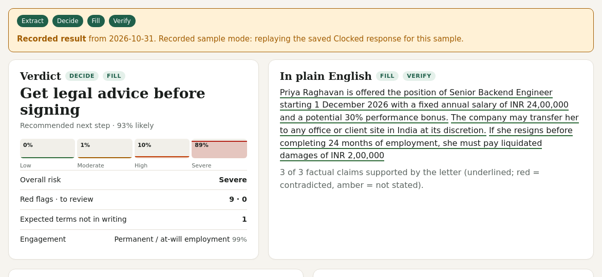
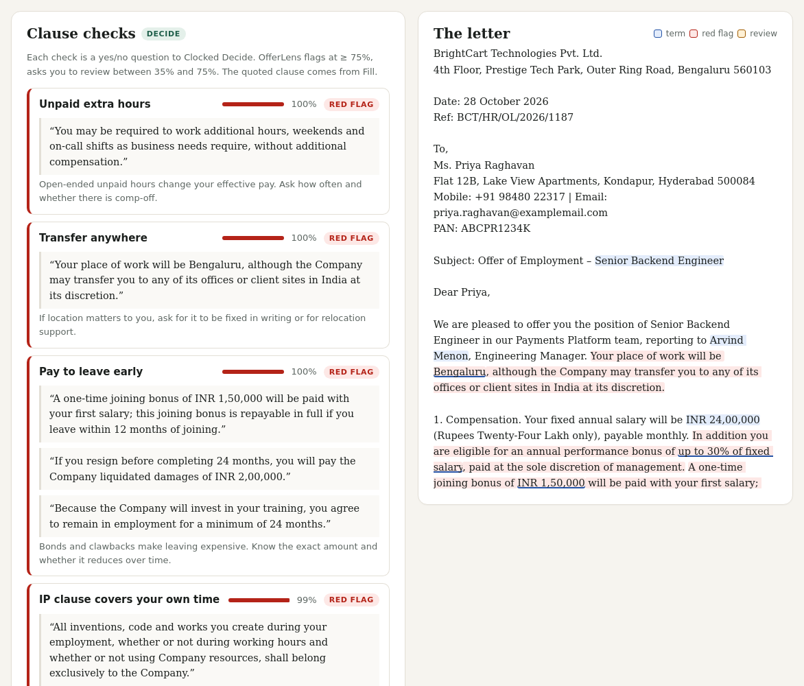
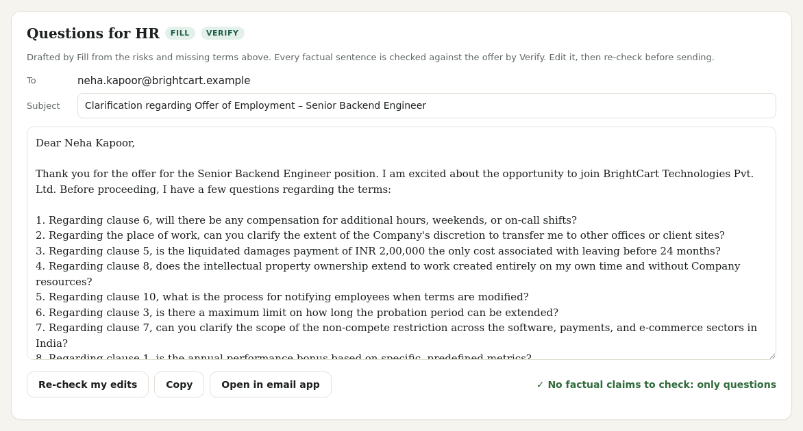

# OfferLens

**Read the fine print before you sign.** Paste a job offer letter or employment contract and OfferLens pulls out every key term with its exact place in the letter, flags clauses that put risk on you (with a probability, not a guess), drafts polite questions to HR, checks that draft against the offer before you send it, and makes a redacted copy you can share for a second opinion.

Built for the **Clocked Build Challenge 2026** on the [Clocked API by Rezolve.ai](https://clocked.rezolve.ai), chaining all five endpoints: **Extract → Decide → Fill → Verify → Protect**.

**Live demo (recorded sample mode):** https://cryptocloud786.github.io/offerlens/

> The GitHub Pages copy is static, so it has no server and no API key. It replays the recorded Clocked responses for the three built-in sample letters and says so in a banner at the top. Run it locally (below) with your own key to analyse any offer live.



## What it does

| Step | Clocked endpoint | What OfferLens gets from it |
|---|---|---|
| 1. Extract | `POST /clocked/extract` | 19 terms (pay, bonus, joining bonus, equity, start date, probation, notice, non-compete, early-exit cost, leave, health cover, hours, reply-by date, reply-to contact…), copied verbatim with character offsets and a normalised date or amount. |
| 2. Decide | `POST /clocked/decide` | Nine yes/no clause checks as probabilities (pay to leave early, broad non-compete, employer can change terms at will, unpaid extra hours, transfer anywhere, IP over your own time…), plus the type of engagement and an overall 4-level risk score. |
| 3. Fill | `POST /clocked/fill` | One call builds the action record: the exact sentence behind each flagged clause, a recommended next step, a three-sentence summary, and an email to HR with one question per risk and per missing term. |
| 4. Verify | `POST /clocked/grounding` | The generated summary and email are split into claims and each is checked against the letter (supported / contradicted / not stated). Bad claims block the "ready to send" state; edits can be re-checked on demand. |
| 5. Protect | `POST /clocked/pii` | A shareable copy with names, emails, phones, addresses, government IDs (PAN, Aadhaar, SSN…) and reference numbers replaced. Names Extract found are passed as deny phrases so they are always caught, and first-name-only mentions ("Dear Priya,") are masked too. |



### How the endpoints chain

```
offer text ──┬─► Extract  (terms + offsets) ─┐
             └─► Decide   (checks, engagement, risk) ─┤   run in parallel
                                                      ▼
                 expected-term list (depends on engagement type)
                 + bands from probabilities (flag / review / clear)
                                                      ▼
             Fill   (evidence per flagged/review clause, next step, summary, HR email)
                                                      ▼
             Verify (claim-by-claim check of the summary + email against the offer)

             Protect runs on demand, seeded with the names Extract found.
```

Extract and Decide only need the letter, so they run concurrently. Fill is built from their results (it only asks for evidence on clauses Decide flagged or wants reviewed, and only asks HR about terms that are missing). Verify checks what Fill wrote. If Fill or Verify fails, the result still renders with what succeeded and lists the failed step as unavailable.

### Uncertainty thresholds

Decide returns a probability for each clause check. OfferLens turns that into policy (`POLICY` in `lib/offerlens.js`):

- **Red flag:** probability **≥ 75%**
- **Review:** **35% to 75%** — shown with the quoted clause and an explanation, so you decide
- **Clear:** below 35% — listed compactly at the bottom

Probabilities are shown next to every check, Extract values below 80% confidence are labelled "NN% sure", and Verify shows its own support percentage per claim.

### Missing-term handling

Extract is told to leave a field empty when the letter does not state it; OfferLens never fills a gap with a guess. Empty fields are split into:

- **Expected but not in writing** → shown as "Not stated: ask HR" and turned into a question in the HR email. For employees: base pay, start date, notice period, paid leave, health cover, working hours, work location. For contractors (engagement type from Decide) leave and health cover are not expected.
- **Not mentioned** → shown greyed out, no question (e.g. equity in a role that does not offer it).



## Setup

Requires Node 18+. There are no npm dependencies.

```bash
git clone https://github.com/cryptocloud786/offerlens.git
cd offerlens
npm i
cp .env.example .env        # then put your key in .env:
#   CLOCKED_API_KEY=clk_live_...
node --env-file=.env server.js   # or: CLOCKED_API_KEY=clk_live_... node server.js
# open http://localhost:3000
```

`server.js` serves `public/` and the same `/api/*` handlers that Vercel runs (`vercel.json` is included if you want to deploy it with serverless functions).

Environment variables (server side only):

| Variable | Default | Purpose |
|---|---|---|
| `CLOCKED_API_KEY` | — | Your Clocked key. Read only by `lib/clocked.js` on the server. |
| `RATE_LIMIT_PER_HOUR` | `20` | Analyses per IP per hour on a public deployment. |
| `CLOCKED_BASE_URL` | `https://clocked.rezolve.ai/clocked` | Override the API base. |
| `PORT` | `3000` | Local server port. |

```bash
npm test             # offline tests, Clocked is mocked (no key, no credits)
npm run record       # re-record the sample responses (spends credits)
```

## Reliability and safety

- **Key stays server-side.** The browser only talks to `/api/analyze`, `/api/verify` and `/api/redact`; it never sees the key. `.env` is git-ignored.
- **Retries with idempotency.** Each logical Clocked request gets one `Idempotency-Key` (UUID) that is reused across retries, so a retry can never be charged twice. `429`, `409` (request in progress) and `5xx` are retried up to 2 times with exponential backoff and jitter; other `4xx` fail fast; each attempt has a 55 s timeout. A response marked `retryAsNew` is not retried with the same key.
- **Rate limit.** A per-IP sliding window (default 20 analyses/hour) protects the shared credit pool on a public demo. When it trips on a built-in sample, the recorded result is served instead and labelled.
- **Cache.** Results are cached in memory by SHA-256 of the input (200 entries, oldest evicted), so re-running the same letter costs no credits and is marked "(cached)".
- **Input limits.** 80 to 20,000 characters.
- **Offsets.** Clocked returns Unicode code-point offsets; the front end maps them to JavaScript UTF-16 indices so highlights land on the right characters even with ₹, é or emoji in the letter.

## Recorded-sample mode

`public/samples/` holds three fictional letters (risky Indian startup offer, UK contractor engagement, clean US offer) and the real Clocked responses recorded for each (`*.analysis.json`, `*.redact.json`, with `recorded_at`).

They are used, and always labelled **"Recorded result"** in the UI, when:

1. **The page is static** (GitHub Pages, `file://`, or `?static=1`): there is no `/api`, so the front end loads the recorded JSON directly and shows a yellow "Recorded sample mode" banner. Only the three samples can be analysed; "Re-check my edits" explains it needs the live API.
2. **The live API is unavailable** (no key, out of credits, Clocked error, or rate limit) and the text is one of the samples: the server or browser falls back to the recording with a notice saying why.

Custom text is never answered from a recording.

## Project layout

```
lib/clocked.js      Clocked client: bearer auth, idempotency key, retries, timeouts
lib/offerlens.js    the pipeline: terms, checks, policy, Extract/Decide/Fill/Verify, Protect
lib/guard.js        rate limit, cache, JSON body parsing
lib/recorded.js     recorded-sample lookup for server fallback
api/                analyze.js, verify.js, redact.js  (Vercel-style handlers)
server.js           local server: static files + the same handlers
public/             front end (no build step) + samples/
scripts/            record-samples.mjs
test/               node:test suite with a mocked Clocked
```

## Disclaimer

OfferLens is a reading aid, not legal advice. Probabilities are model judgements; read the quoted clause yourself before acting on it. All sample letters, people and companies are fictional.

## License

[MIT](LICENSE) © 2026 Abdul AmberNeel
